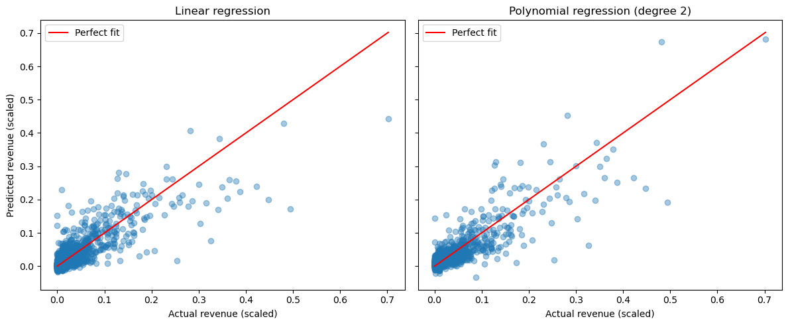
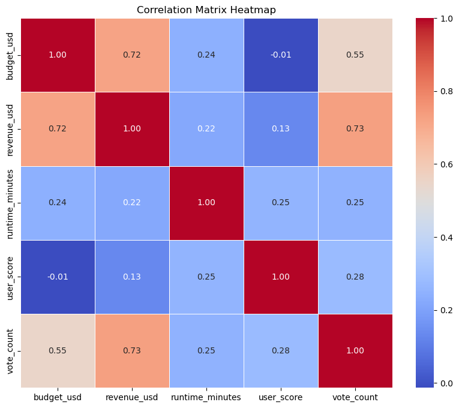
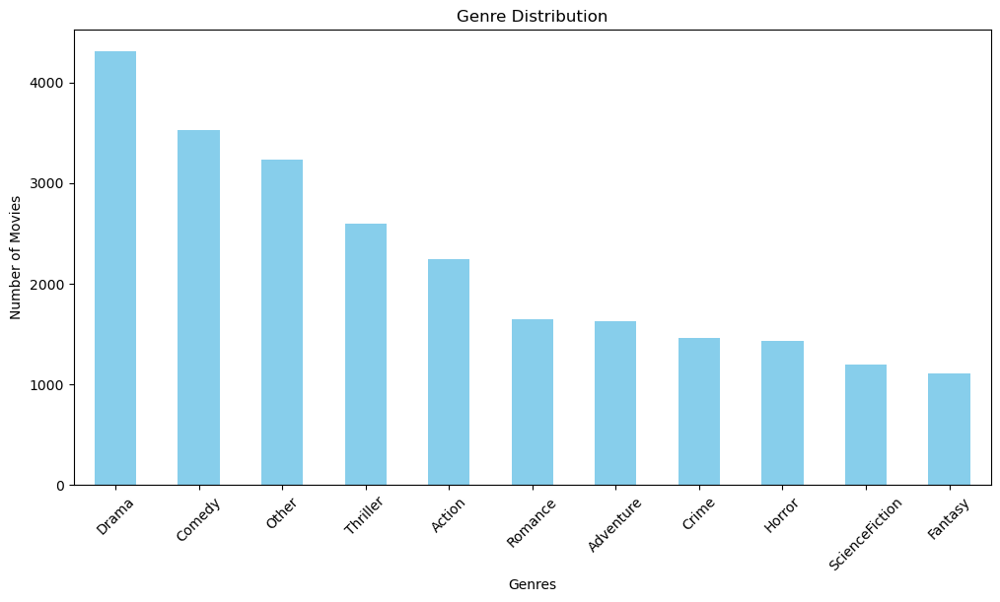

# Movie Revenue Prediction

A data science project that predicts a movie's **box-office revenue** from its budget, runtime, user score, vote count, genres and language. It covers the whole workflow: merging and cleaning two datasets, encoding categorical features, statistical analysis and visualisation, then linear and polynomial regression with cross-validation. Built in Python with pandas and scikit-learn.

[](https://colab.research.google.com/github/ziadelh/movie-revenue-prediction/blob/main/movie_revenue.ipynb)



| Model | Test R² |
|---|---|
| Linear regression | 0.681 (5-fold cross-validation: 0.684) |
| Polynomial regression (degree 2) | **0.734** |

Evaluated on a held-out 20% test split (1,944 movies). Revenue values in the plots are Min-Max scaled to the range 0 to 1.

<table>
  <tr>
    <td></td>
    <td></td>
  </tr>
</table>

## What it does

- **Data preparation:** merges `FilmDetails.csv` and `Movies.csv` on the movie ID, fills missing budgets and revenues with the median, keeps the top 10 genres and top 5 languages (everything else becomes `Other`) and one-hot encodes them, combines runtime hours and minutes, and Min-Max scales the numeric columns
- **Statistical analysis:** mean, median and mode, variance, standard deviation, range and IQR, skewness and kurtosis for the key columns, each with a chart, plus a genre distribution and a correlation matrix
- **Models:** linear regression and degree-2 polynomial regression on 21 features, evaluated with MSE and R²
- **Findings:** revenue is most strongly correlated with vote count (0.73) and budget (0.72); revenue, budget and vote count are all heavily right-skewed, and both models underestimate the biggest blockbusters

## Dataset

[Which movie should I watch today?](https://www.kaggle.com/datasets/hassanelfattmi/which-movie-should-i-watch-today) by hassanelfattmi on Kaggle (CC BY 4.0): 9,718 movies collected from The Movie Database (TMDb). Copies of the two files used are included in `data/`.

*This product uses the TMDB API but is not endorsed or certified by TMDB.*

## Run

```bash
pip install pandas numpy scikit-learn seaborn matplotlib scipy jupyter
jupyter notebook movie_revenue.ipynb
```

Or use the **Open in Colab** button above, which loads the data from this repository.

## Tech Stack

Python · pandas · NumPy · scikit-learn · matplotlib · seaborn

## Author

Ziad Elhussein
